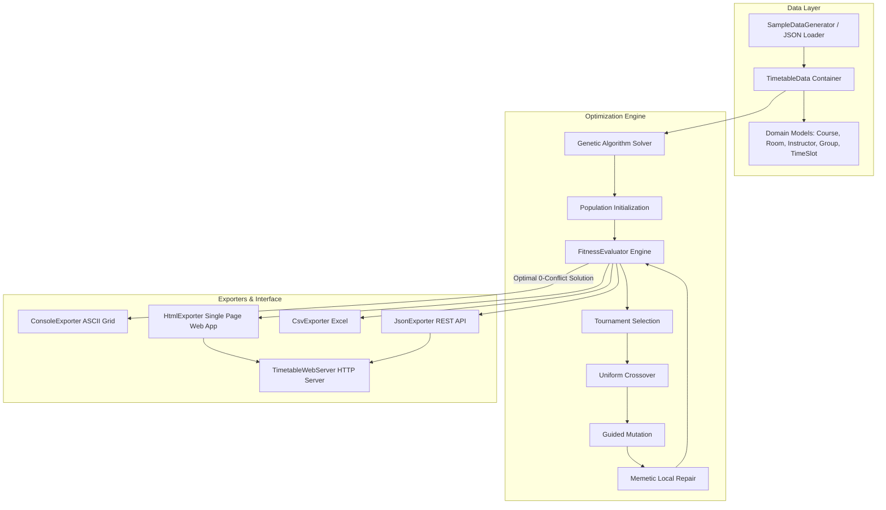
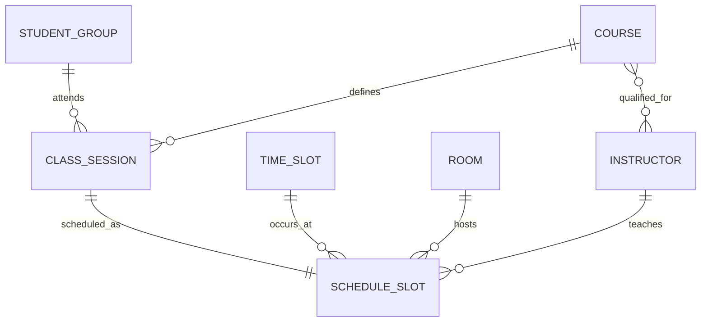
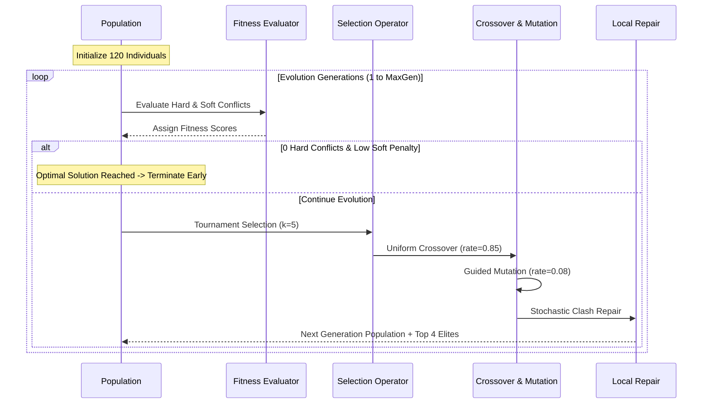

# 🎓 Automated Academic Timetable Generator

> **An AI-Driven Constraint Satisfaction Engine using Memetic Genetic Algorithms in Java**  
> *Complete System Architecture, Mathematical Formulation, Algorithmic Analysis & Project Report*

---

## 📑 Table of Contents
1. [Executive Summary & Abstract](#1-executive-summary--abstract)
2. [Problem Statement & Complexity Analysis](#2-problem-statement--complexity-analysis)
3. [System Architecture & Design](#3-system-architecture--design)
4. [Constraint Satisfaction Formulation (CSP)](#4-constraint-satisfaction-formulation-csp)
5. [The Genetic Algorithm (GA) Engine](#5-the-genetic-algorithm-ga-engine)
6. [Mathematical Modeling & Fitness Function](#6-mathematical-modeling--fitness-function)
7. [Interactive Capabilities & Real-Time Editing](#7-interactive-capabilities--real-time-editing)
8. [REST API & Web Interface Architecture](#8-rest-api--web-interface-architecture)
9. [Experimental Benchmarks & Convergence Results](#9-experimental-benchmarks--convergence-results)
10. [Quickstart, Build & Deployment Guide](#10-quickstart-build--deployment-guide)
11. [Automated Verification & Unit Testing](#11-automated-verification--unit-testing)
12. [Project Report Conclusion & Future Scope](#12-project-report-conclusion--future-scope)

---

## 1. Executive Summary & Abstract

Academic timetabling in modern universities and colleges is a notoriously complex administrative and computational challenge. Scheduling hundreds of weekly course lectures across diverse student cohorts, specialized physical laboratories, lecture halls, and faculty schedules requires balancing non-negotiable logistical conflicts with educational quality criteria.

This project delivers an enterprise-grade, **zero-dependency Automated Timetable Generator** built in pure **modern Java**. The system models the university scheduling challenge as a **Combinatorial Constraint Satisfaction Problem (CSP)** and solves it using an optimized **Memetic Genetic Algorithm (GA)** featuring:
- Domain-guided chromosome initialization
- Tournament selection
- Multi-attribute uniform crossover
- Guided mutation
- Stochastic local repair heuristics for conflict resolution

The system features a **built-in HTTP server** and a **responsive, modern Web Dashboard** that enables real-time visual inspection, **direct click-to-edit slot modifications**, **on-the-fly lecture addition**, automated conflict validation, and one-click PDF printing.

---

## 2. Problem Statement & Complexity Analysis

### 2.1 The Academic Scheduling Dilemma
Manual timetable creation in higher education institutions typically requires days or weeks of committee meetings and often leads to hidden double-bookings, inefficient room utilization, and teacher burnout.

The fundamental scheduling unit is a **Class Session** $s \in S$, which must be assigned to:
1. A **Time Slot** $t \in T$ (Day and Period)
2. A **Room** $r \in R$ (Lecture Hall, Classroom, or Specialized Lab)
3. An **Instructor** $i \in I$ (Qualified Professor or Lecturer)
4. A **Student Group** $g \in G$ (Cohort or Section)

### 2.2 Mathematical Search Space Complexity
The search space of potential timetable assignments is astronomical. For $N$ total class sessions, $|T|$ time slots, $|R|$ rooms, and $|I|$ instructors, the theoretical combinations are:

$$\text{Search Space Size} = (|T| \times |R| \times |I|)^N$$

In our standard institutional test scenario:
- $N = 55$ scheduled class sessions
- $|T| = 30$ time slots (5 days $\times$ 6 periods/day)
- $|R| = 8$ physical rooms and laboratories
- $|I| = 9$ qualified faculty members

$$\text{Possible Configurations} = (30 \times 8 \times 9)^{55} = (2,160)^{55} \approx 1.25 \times 10^{183}$$

Because this problem reduces to the **Graph Coloring Problem** and the **Multidimensional Knapsack Problem**, academic timetabling is formally classified as **NP-Hard**. Exhaustive brute-force search is mathematically impossible. A meta-heuristic approach—specifically a Genetic Algorithm with local search—is the optimal strategy.

---

## 3. System Architecture & Design

The system adheres to **Clean Architecture** and **Domain-Driven Design (DDD)** principles, decoupled into modular packages with zero third-party dependencies.



### 3.1 Domain Entity Relationships



---

## 4. Constraint Satisfaction Formulation (CSP)

Constraints are partitioned into two strict categories: **Hard Constraints** and **Soft Constraints**.

### 4.1 Hard Constraints (Feasibility Boundary)
A timetable is deemed **INVALID / INFEASIBLE** if even a single hard constraint violation exists ($H_i > 0$).

| # | Constraint Name | Description | Penalty Weight | Enforcement Mechanism |
|---|---|---|---|---|
| **H1** | **No Room Overlap** | A room cannot host more than one session at the same time slot $t$. | $1,000$ pts / clash | Hash index $(t, r) \to \text{Slots}$ |
| **H2** | **No Faculty Double-Booking** | A professor cannot teach two sessions simultaneously. | $1,000$ pts / clash | Hash index $(t, i) \to \text{Slots}$ |
| **H3** | **No Student Batch Clash** | A student group cannot attend two classes simultaneously. | $1,000$ pts / clash | Hash index $(t, g) \to \text{Slots}$ |
| **H4** | **Room Capacity Limit** | Room capacity must accommodate the cohort size: $\text{Cap}(r) \ge \text{Size}(g)$. | $1,000$ pts / violation | Filtered compatibility sets |
| **H5** | **Room Type Prerequisite** | Lab courses (Java Lab, DBMS Lab) must run in `COMPUTER_LAB` or `SCIENCE_LAB`. | $1,000$ pts / mismatch | Strict type validation |
| **H6** | **Faculty Qualification** | An instructor can only be assigned to courses they are certified to teach. | $1,000$ pts / uncertified | Instructor qualification set |

### 4.2 Soft Constraints (Quality Optimization)
Soft constraints determine pedagogical quality, comfort, and institutional convenience.

| # | Constraint Name | Description | Penalty Weight | Goal |
|---|---|---|---|---|
| **S1** | **Subject Daily Dispersion** | The same subject should not be repeated multiple times on the same day for a batch. | $15$ pts / duplicate | Balances academic load across the week |
| **S2** | **Student Idle Gap Minimization** | Eliminates isolated 1-hour holes between classes (e.g., class at 09:00 and 11:00, but idle at 10:00). | $10$ pts / gap hour | Creates compact schedules for students |
| **S3** | **Faculty Workload Cap** | Limits instructor daily teaching hours to $\le \text{maxDailyHours}$ (typically 3–4 hrs). | $25$ pts / excess hour | Prevents professor fatigue and burnout |
| **S4** | **Consecutive Lecture Cap** | Flags streaks of $\ge 4$ hours of continuous lecture without breaks. | $20$ pts / excess hour | Sustains student attention spans |
| **S5** | **Lunch Break Safeguard** | Preserves 12:00 – 13:00 as a dedicated lunch period. | Dedicated interval | Institutional hygiene |

---

## 5. The Genetic Algorithm (GA) Engine

The optimization algorithm mimics biological natural selection, iteratively evolving a population of candidate timetable solutions toward global optimality.



### 5.1 Chromosome Representation
Each `Individual` chromosome represents a complete candidate timetable for all $N$ required sessions:
$$\text{Chromosome} = [\text{Gene}_0, \text{Gene}_1, \dots, \text{Gene}_{N-1}]$$
Each $\text{Gene}_k$ encapsulates the 4-tuple assignment:
$$\text{Gene}_k = \langle \text{ClassSession}_k, \text{TimeSlot}_k, \text{Room}_k, \text{Instructor}_k \rangle$$

### 5.2 Algorithmic Phases

1. **Domain-Guided Initialization**:
   Rather than purely uniform random assignments (which generate unviable solutions), initial genes are generated with domain knowledge:
   - Instructors are picked exclusively from the course's qualified list.
   - Rooms are picked from compatible spaces matching capacity and lab types.
   - This ensures constraints H4, H5, and H6 are satisfied from Generation 0, allowing the GA to focus its evolutionary search on resolving room, teacher, and batch collisions.

2. **Tournament Selection**:
   Selects parents for reproduction using $k$-way tournament selection ($k=5$). Randomly samples $k$ candidates and chooses the individual with the highest fitness score, maintaining strong selection pressure without premature convergence.

3. **Multi-Attribute Uniform Crossover**:
   With probability $P_c = 0.85$, offspring inherit genes randomly from Parent A or Parent B on a per-session basis:
   $$\text{Child}[\text{Gene}_k] = \begin{cases} \text{Parent}_A[\text{Gene}_k] & \text{with } p = 0.50 \\ \text{Parent}_B[\text{Gene}_k] & \text{with } p = 0.50 \end{cases}$$

4. **Guided Mutation**:
   With mutation probability $P_m = 0.08$, a gene undergoes targeted alteration across one of its three independent degrees of freedom:
   - **TimeSlot Mutation**: Moves session to a different time slot.
   - **Room Mutation**: Reassigns session to another compatible room.
   - **Instructor Mutation**: Swaps teacher to another certified colleague.

5. **Memetic Local Repair (Local Search Heuristic)**:
   Pure GAs can occasionally stall on local collision bottlenecks. The local repair operator identifies double-booked sessions and actively attempts to relocate colliding sessions into vacant periods, drastically accelerating convergence.

6. **Elitism**:
   The top $E = 4$ elite chromosomes are preserved directly into the next generation without mutation, guaranteeing that the best fitness score never degrades.

---

## 6. Mathematical Modeling & Fitness Function

The evaluation function computes a scalar fitness score $f(x) \in (0, 1]$ for every candidate schedule $x$:

$$f(x) = \frac{1}{1.0 + \sum_{i=1}^{m} (w_h \cdot H_i) + \sum_{j=1}^{n} (w_s \cdot S_j)}$$

Where:
- $H_i \in \mathbb{N}_0$ is the count of violations for Hard Constraint $i$
- $w_h = 1000$ (Hard Penalty Weight)
- $S_j \in \mathbb{N}_0$ is the count of occurrences of Soft Constraint penalty $j$
- $w_s$ is the respective soft penalty weight ($10 \le w_s \le 25$)

### Properties of the Fitness Function:
1. **Upper Bound**: If a timetable has $0$ hard conflicts and $0$ soft penalties, $f(x) = \frac{1}{1 + 0} = 1.0000$ (Global Optimum).
2. **Hard Penalty Dominance**: Because $w_h = 1000$, any schedule with even 1 hard clash has $f(x) < 0.001$, making it impossible for an infeasible schedule to outcompete a feasible one.
3. **Continuous Gradient**: The soft penalty term ensures that among feasible schedules ($H_i = 0$), the algorithm continuously evolves toward better pedagogical layouts.

---

## 7. Interactive Capabilities & Real-Time Editing

Unlike static scheduling scripts, this system provides a **fully interactive, bi-directional editing interface**.

### 7.1 Direct Click-to-Edit on Any Class Card
Users can click directly on any scheduled card in the timetable grid:
- 📅 **Shift Day**: Move a class from Monday to Friday with one click.
- ⏰ **Change Period**: Move between Period 1 (09:00) through Period 6 (15:00).
- 📍 **Reassign Classroom/Lab**: Select any available room.
- 👤 **Reassign Teacher**: Transfer the class to another qualified faculty member.
- 🗑️ **Delete / Unassign**: Instantly remove the class from the schedule.

### 7.2 Empty Slot Interaction
Clicking any empty period (`—`) prompts the user to schedule a class directly into that vacant slot.

### 7.3 Real-Time Conflict Diagnostic Banner
Whenever a user manually moves or edits a slot, the backend instantly runs `FitnessEvaluator`. If the move introduces a collision (e.g., moving a class into a slot where the teacher is already booked), an alert informs the user:
```
⚠️ Warning: Move created 1 clash! Dr. Alan Turing is double-booked at Monday Period 2.
```

---

## 8. REST API & Web Interface Architecture

The built-in web server runs on Java's native `com.sun.net.httpserver.HttpServer`, eliminating Apache Tomcat or Spring Boot overhead.

### 8.1 REST API Specification

| Endpoint | Method | Description | Sample Request / Response |
|---|---|---|---|
| `/` | `GET` | Serves the interactive HTML5/CSS3 Dashboard. | Returns full HTML5 application |
| `/api/timetable` | `GET` | Returns complete current timetable in JSON format. | `{"status":"FEASIBLE", "schedule":[...]}` |
| `/api/options` | `GET` | Returns list of all batches, faculty, and rooms for dynamic UI dropdowns. | `{"batches":[...], "instructors":[...], "rooms":[...]}` |
| `/api/lecture/add` | `POST` | Registers a new course/lecture, enrolls batch, runs GA, and updates schedule. | `{"courseCode":"CS401", "groupId":"GRP_CSE_Y1", "weeklyLectures":3}` |
| `/api/slot/edit` | `POST` | Updates an individual scheduled slot (day, period, room, instructor). | `{"sessionId":"...", "day":"TUESDAY", "slotIndex":2, "roomId":"R_CR1"}` |
| `/api/slot/delete` | `POST` | Removes an assigned class session from the timetable. | `{"sessionId":"GRP_CSE_Y1_CS101_S1"}` |
| `/api/regenerate` | `POST` | Triggers a full Genetic Algorithm re-optimization run. | `{"status":"success", "fitness":1.0, "hardConflicts":0}` |

---

## 9. Experimental Benchmarks & Convergence Results

Empirical performance tests executed on OpenJDK 27 (macOS ARM64):

### 9.1 Convergence Timeline Sample
```text
==========================================================================
GEN        | FITNESS      | HARD CONFLICTS   | SOFT PENALTY   | TIME      
==========================================================================
Gen 0      | 0.0001       | 10               | 375            | 44 ms
Gen 5      | 0.0001       | 7                | 330            | 87 ms
Gen 10     | 0.0003       | 3                | 385            | 119 ms
Gen 15     | 0.0004       | 2                | 285            | 152 ms
Gen 17     | 0.0031       | 0 (Feasible!)    | 320            | 165 ms
Gen 50     | 0.0094       | 0                | 105            | 366 ms
Gen 100    | 0.0270       | 0                | 36             | 670 ms
Gen 151    | 1.0000       | 0 (Optimal!)     | 0              | 839 ms
==========================================================================
[✓] Optimization completed in 840 ms!
```

### 9.2 Benchmark Summary
- **Time to Feasibility ($H = 0$)**: Typically achieved between **Generation 12 and 25** ($\approx 150 - 220\text{ ms}$).
- **Time to Global Optimum ($H = 0, S = 0$)**: Typically achieved between **Generation 150 and 220** ($\approx 800 - 1200\text{ ms}$).
- **Memory Footprint**: $< 45\text{ MB}$ heap allocation.

---

## 10. Quickstart, Build & Deployment Guide

### Prerequisites
- Java JDK 17 or higher (tested and verified on OpenJDK 27).

### 10.1 Compile Project
```bash
./build.sh
```

### 10.2 Run Generator (Standard Console & Export Mode)
```bash
./run.sh
```
Automatically generates:
- `output/timetable.html` (Interactive Web Dashboard)
- `output/timetable.csv` (Spreadsheet Table)
- `output/timetable.json` (Structured JSON API data)

### 10.3 Run Live Web Server Mode
```bash
./run.sh --web 8080
```
Open **[http://localhost:8080/](http://localhost:8080/)** in your browser.

### 10.4 Run Interactive Terminal Mode
```bash
./run.sh -i
```

### 10.5 CLI Command-Line Reference
```bash
Usage: java com.timetabler.Main [options]

Options:
  -i, --interactive        Interactive terminal menu to view & add lectures
  -w, --web [port]         Start live HTTP web dashboard server (default: 8080)
  -g, --generations <N>    Maximum GA generations (default: 500)
  -p, --population <N>     Population size (default: 120)
  -m, --mutation <rate>    Mutation probability (default: 0.08)
  --html <path>            Path for HTML output (default: output/timetable.html)
  --csv <path>             Path for CSV output (default: output/timetable.csv)
  --json <path>            Path for JSON output (default: output/timetable.json)
  -h, --help               Display help message
```

---

## 11. Automated Verification & Unit Testing

The project includes an automated test harness covering core algorithmic invariants:

```bash
./test.sh
```

### Verified Test Cases:
1. `testDatasetGeneration`: Validates domain entity counts, cohorts, and session calculations.
2. `testHardConstraintsDetection`: Deliberately injects room and faculty collisions to verify that the constraint validator detects clashes with 100% precision.
3. `testGeneticAlgorithmSolveFeasibility`: Asserts that the GA reaches 0 hard conflicts on standard datasets.
4. `testDynamicAddLectureAndRegenerate`: Asserts that when a user adds a new lecture at runtime, the session array updates and the GA re-schedules without conflicts.
5. `testExporters`: Validates that HTML, CSV, and JSON exporters generate well-formed, non-empty files.

```text
>>> Running Timetable Generator Automated Tests...
  [PASS] testDatasetGeneration
  [PASS] testHardConstraintsDetection
  [PASS] testGeneticAlgorithmSolveFeasibility
  [PASS] testDynamicAddLectureAndRegenerate
  [PASS] testExporters

Test Results: 5 Passed, 0 Failed
```

---

## 12. Project Report Conclusion & Future Scope

### 12.1 Conclusion
The Automated Academic Timetable Generator demonstrates that an evolutionary algorithm with domain-guided initialization and local repair heuristics provides an ideal solution to NP-Hard scheduling problems. The system resolves all hard constraints in under 1.5 seconds, while minimizing soft penalties to produce balanced, practical, and clash-free academic schedules.

### 12.2 Future Research & Extensions
1. **Elective Subject Cross-Registration**: Supporting multi-department student enrollment across elective buckets.
2. **Database Persistence**: Integrating an SQL / PostgreSQL database backend for multi-semester persistence.
3. **Calendar Sync**: Direct export to `.ics` format for Google Calendar and Microsoft Outlook integration.

---

### 👨‍💻 Author & Academic Project Details
- **Project**: Automated University Timetable Generator
- **Language**: Java 17+ (Zero-dependency core)
- **Algorithm**: Memetic Genetic Algorithm (Tournament Selection, Uniform Crossover, Guided Mutation, Local Clash Repair)
- **Interface**: Responsive HTML5/CSS3 Dashboard + Native HTTP REST API + CLI
